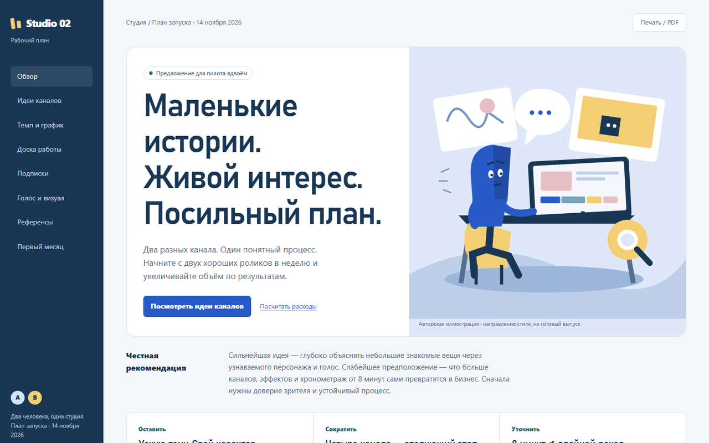

# Studio 02 – Working Plan

A local, interactive launch plan for a two-person video studio, dated 14 November 2026. It is one static `index.html` with no accounts or backend; the text is in Russian. Sections: overview, channel ideas, pace and schedule, work board, subscriptions and budget, voice and visuals, references, first month. The board and budget settings are kept in the browser's `localStorage`, and the board can be saved as CSV.



**[Open the plan](https://antropos17.github.io/youtube-studio-plan/)**

## Use

Open `index.html` in a browser, or serve the folder:

```bash
python -m http.server 8000
```

The `preview-*.png` files in the repository root are earlier layout previews.

## Stack

Plain HTML, CSS and JavaScript in a single file.
